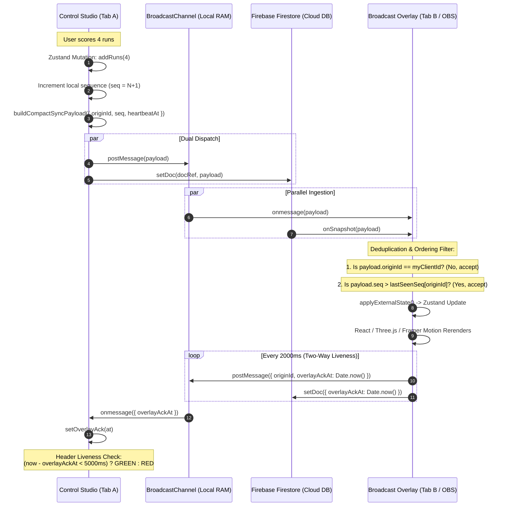

# AR-Sports System Architecture

## Overview
AR-Sports separates broadcast concerns into a decoupled **Controller** (Scorer Studio) and **Renderer** (Clean Graphics Overlay). Communication is multi-channel, peer-deduplicated, and protected by heartbeat telemetry.

---

## Data Flow Diagram



---

## 1. Store State & Local Persistence

The state engine is managed by Zustand (`src/store/useBroadcastStore.ts`):
- **Core Entities**:
  - `teamA`, `teamB`: Roster, players, bowler statistics, batting statistics, team color tokens.
  - `matchDetails`: Tournament name, venue, match format (overs, balls per over), sponsors array.
  - `activeBatters`, `activeBowler`, `score`, `wickets`, `overs`, `balls`.
  - `activeOverlays`: Set of active graphic layers (`sponsorGraphics`, `battingCard`, `bowlerCard`, `wagonWheel`, etc.).
  - `ballLog`: Pre-mutation ball-by-ball chronological audit ledger.
  - `matchArchive`: Cold-storage archive of completed matches persisted in `localStorage.ar_sports_archive`.
- **Durability**:
  - Every state mutation triggers a synchronous write to `localStorage.ar_sports_broadcast_v1`.
  - Tab crash, hard reload, or power loss resumes immediately from the last local ball.

---

## 2. Sync Engine & Origin Deduplication

To support both single-machine zero-latency broadcast (same-PC OBS) and remote distributed multi-scorer setups without race conditions, AR-Sports implements origin-tagged sequencing:

### Tab Identity
- Every tab initializes a unique, ephemeral UUID at launch:
  ```ts
  const clientId = crypto.randomUUID();
  ```

### Payload Structure
```ts
interface CompactSyncPayload {
  originId: string;      // Emitting tab UUID
  seq: number;           // Monotonically increasing integer
  heartbeatAt: number;   // Timestamp of emission
  matchId: string;       // Partition ID
  state: Partial<BroadcastStoreState>;
}
```

### Ingestion Filter Rules (`applyExternalState`)
When an external state payload arrives via `BroadcastChannel` or Firestore `onSnapshot`:
1. **Self-Echo Suppression**:
   ```ts
   if (payload.originId === clientId) return; // Drop own reflected writes
   ```
2. **Monotonic Sequence Enforcement**:
   ```ts
   const lastSeq = lastKnownSeqByOrigin.get(payload.originId) ?? 0;
   if (payload.seq <= lastSeq) return; // Drop duplicate or out-of-order packets
   lastKnownSeqByOrigin.set(payload.originId, payload.seq);
   ```
3. **Execution**: The filtered payload is committed into the local Zustand store.

---

## 3. Two-Way Heartbeat & Health Monitoring

To detect frozen browser sources, crashed graphics engines, or network partitions in real time:

1. **Controller Probe**: Emits `heartbeatAt: Date.now()` on every state publication.
2. **Overlay Acknowledgment**:
   - The overlay component initiates an autonomous 2000ms background heartbeat timer.
   - Emits `{ originId: clientId, overlayAckAt: Date.now() }` back across the bus.
   - Unmount hook cleanly disposes of the timer interval.
3. **Controller UI Indicator**:
   - A dedicated 1-second decoupled interval in `ControlStudio` calculates:
     $$\Delta t = \text{Date.now()} - \text{overlayAckAt}$$
   - **Condition**:
     - $\Delta t \le 5000\text{ms}$: Renders solid green `OVERLAY LIVE` status badge.
     - $\Delta t > 5000\text{ms}$: Renders pulsing red `⚠ NO OVERLAY DATA (Xs)` warning badge and increments `syncErrorCount`.
